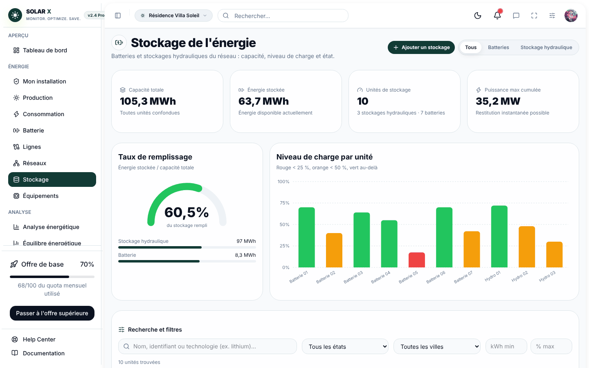
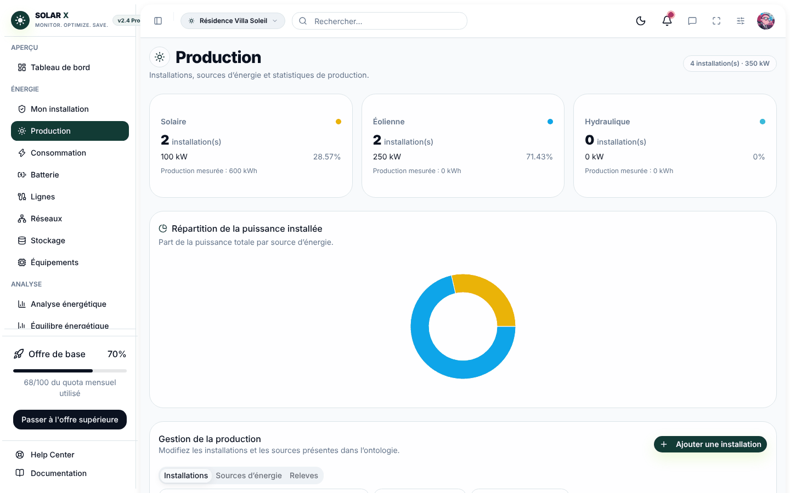
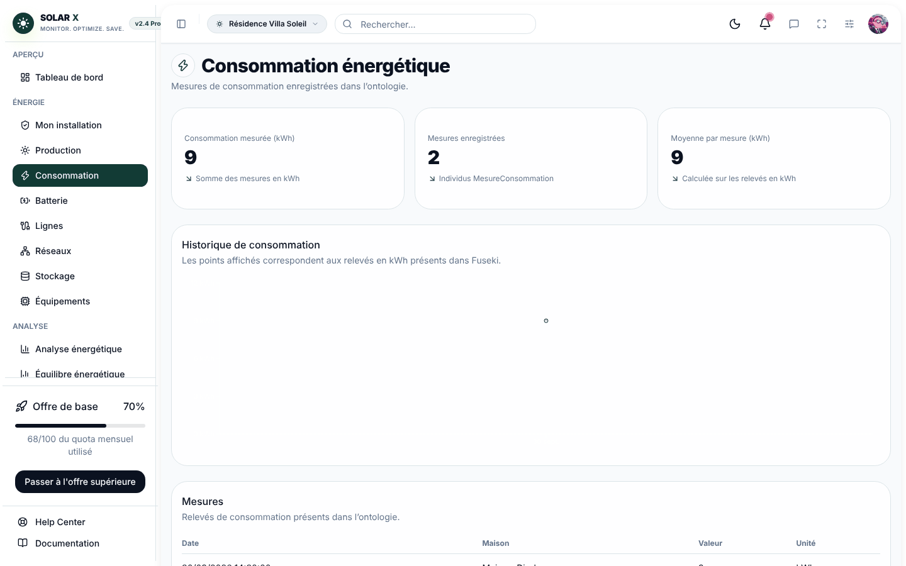
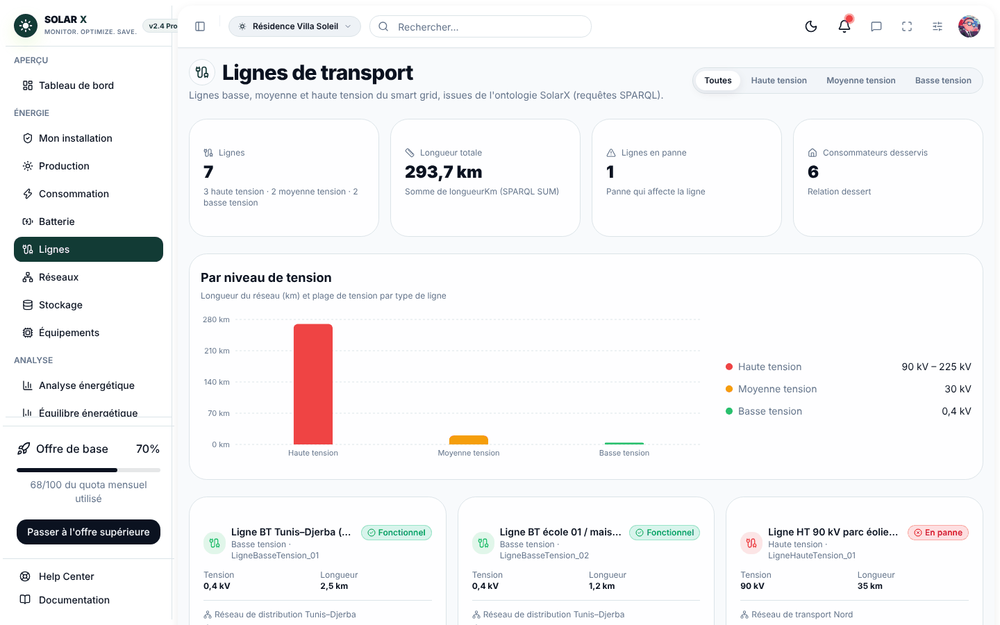
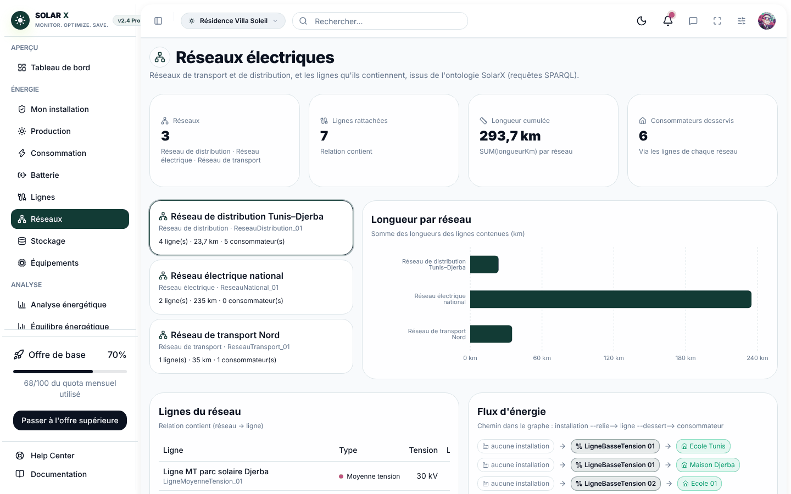
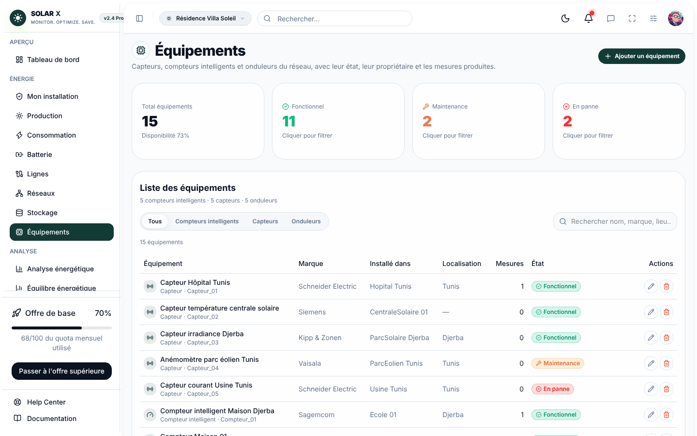
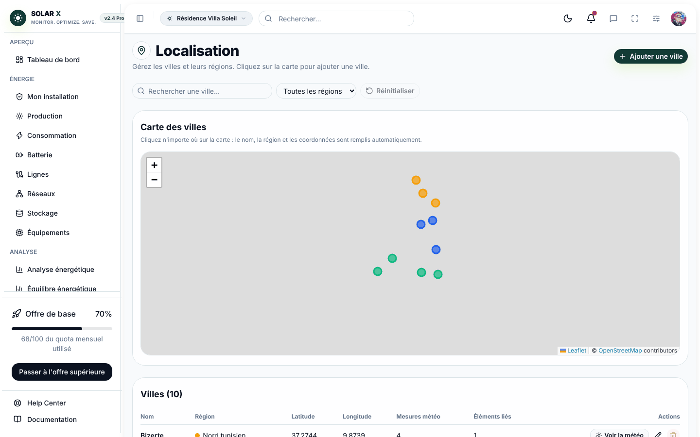
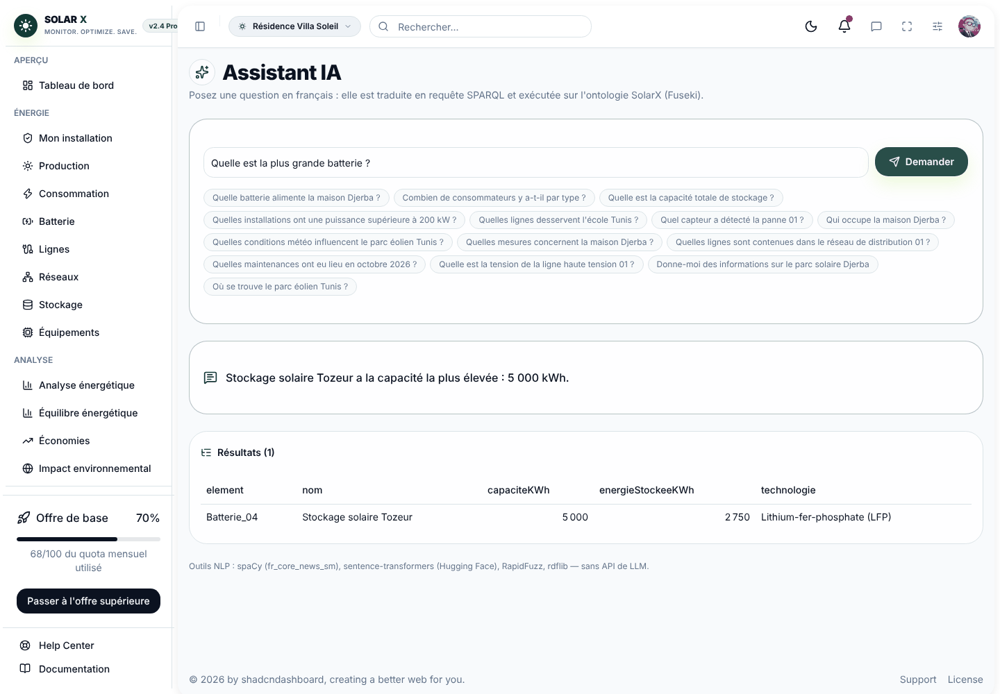

# SolarX

**Une modélisation sémantique d'un système énergétique — Énergie et Smart Grid.**

Application web qui représente un réseau électrique intelligent sous forme d'ontologie OWL : sources et installations de production, stockage, lignes et réseaux, bâtiments consommateurs, équipements de mesure, conditions météo et incidents. Les données sont interrogées en SPARQL et un assistant traduit les questions en français en requêtes SPARQL.

Projet Web Sémantique — ESPRIT · 5TWIN4 · équipe DevWave · 2026–2027

OWL 2 · Protégé · Apache Jena Fuseki · SPARQL 1.1 · FastAPI · Python · React 19 · Vite · Tailwind CSS 4 · spaCy · sentence-transformers



## Sommaire

- [Présentation](#présentation)
- [Captures](#captures)
- [Modules et fonctionnalités](#modules-et-fonctionnalités)
- [L'ontologie](#lontologie)
- [Requêtes SPARQL](#requêtes-sparql)
- [Module NLP : du français au SPARQL](#module-nlp--du-français-au-sparql)
- [Architecture et technologies](#architecture-et-technologies)
- [Installation locale](#installation-locale)
- [Configuration](#configuration)
- [API](#api)
- [Tests](#tests)
- [Organisation du dépôt](#organisation-du-dépôt)
- [Dépannage](#dépannage)
- [Équipe, contribution et crédits](#équipe-contribution-et-crédits)

## Présentation

Un smart grid relie production, stockage, transport et consommation, avec des capteurs qui suivent l'énergie à chaque étape. SolarX représente ces composants et leurs relations dans une ontologie, puis les rend consultables dans une application web.

```
Source solaire → Centrale solaire → Batterie / Réseau → Ligne électrique → Maison → Consommateur
                                                                      ↑
                                         Capteurs, compteurs et onduleurs mesurent chaque étape
```

Objectifs du projet :

- représenter les sources et les installations de production ;
- modéliser le stockage de l'énergie ;
- représenter les bâtiments et les consommateurs ;
- modéliser le réseau électrique et le transport ;
- intégrer les équipements et les mesures énergétiques ;
- localiser les différents éléments ;
- définir les relations sémantiques entre les concepts ;
- associer des données énergétiques pour l'analyse et les calculs.

Les valeurs de l'ontologie (capacités, puissances, mesures) sont des **données de démonstration** créées pour le projet. Elles ne décrivent pas des installations réelles.

## Captures

Captures prises sur la version locale du dépôt (backend, frontend et ontologie de la branche principale, avec le module Stockage + Équipement chargé).

| | |
|---|---|
| **Production** — installations et sources d'énergie, répartition de la puissance<br> | **Consommation** — mesures de consommation enregistrées<br> |
| **Lignes de transport** — tension, longueur, état<br> | **Réseaux électriques** — lignes contenues et flux d'énergie<br> |
| **Stockage** — capacité, remplissage, niveau de charge<br> | **Équipements** — capteurs, compteurs, onduleurs et état<br> |
| **Localisation** — villes et régions sur une carte<br> | **Assistant IA** — question en français traduite en SPARQL<br> |

La page Météo affiche les données d'Open-Meteo et nécessite une connexion Internet ; elle n'est pas capturée ici. Le tableau de bord d'accueil provient du modèle d'interface et affiche des valeurs d'exemple.

## Modules et fonctionnalités

| Module | Classes de l'ontologie | Page | Fonctionnalités |
|---|---|---|---|
| Production | `InstallationProduction` (`CentraleSolaire`, `ParcEolien`, `CentraleHydraulique`), `SourceEnergie` (`Solaire`, `Eolienne`, `Hydraulique`), `MesureProduction` | `/production` | CRUD des installations, des sources et des mesures ; statistiques par type de source. |
| Stockage | `Stockage` (`Batterie`, `StockageHydraulique`) | `/stockage` | Capacité totale et énergie stockée par type, niveau de charge, CRUD, recherche et filtres (état, ville, capacité, charge). |
| Équipement | `Equipement` (`Capteur`, `CompteurIntelligent`, `Onduleur`) | `/equipements` | État calculé depuis les maintenances, propriétaire et localisation, mesures produites, CRUD, recherche et filtres. |
| Consommateurs et mesures | `Consommateur` (`Maison`, `Ecole`, `Hopital`, `Usine`…), `MesureConsommation` | `/consumption` | CRUD des consommateurs, équipements installés, mesures de consommation. |
| Lignes et réseaux | `LigneTransport` (basse, moyenne, haute tension), `ReseauElectrique` (`ReseauTransport`, `ReseauDistribution`) | `/lignes`, `/reseaux` | Lignes par niveau de tension, consommateurs desservis, installations reliées, état selon les incidents, longueur totale par réseau. |
| Localisation et météo | `Localisation` (`Ville`, `Region`), `ConditionMeteo` (`Ensoleillement`, `Temperature`, `VitesseVent`…) | `/localisation`, `/meteo`, `/historique-meteo` | CRUD des villes, carte, géocodage inverse, météo actuelle (Open-Meteo), relevés enregistrés, alertes. |
| Événements et incidents | `Incident` (`Panne`, `Surcharge`, `Alerte`), `Maintenance` (préventive, corrective, prédictive, inspection) | — | Utilisés par les autres modules pour calculer l'état d'une ligne, d'un stockage ou d'un équipement. |
| Équilibre énergétique | `MesureProduction`, `MesureConsommation` | `/energy-balance` | Production, consommation et surplus par période. |
| Assistant IA | toute l'ontologie | `/assistant-ia` | Question en français → requête SPARQL → résultats et réponse rédigée. |

Le calcul d'état suit la même règle partout : une propriété `etat` déclarée est prioritaire ; sinon une `Panne` qui `affecte` l'élément donne « En panne », un autre incident donne « Alerte », une `Maintenance` qui `porteSur` un équipement donne « Maintenance » ; sinon l'élément est « Fonctionnel ».

## L'ontologie

| Fichier | Contenu |
|---|---|
| `database/solarx.owl` | Ontologie commune (RDF/XML, 619 triplets), éditée dans Protégé. |
| `database/p2_stockage_equipement.ttl` | Module Stockage + Équipement (Turtle, 257 triplets) : individus, 5 propriétés de données et axiomes. Il complète `solarx.owl` sans le modifier. |

Espace de noms : `http://www.semanticweb.org/monta/ontologies/2026/10/SolarX#`

Avec les deux fichiers : 56 classes, 30 propriétés objet, 24 propriétés de données et 89 individus nommés.

### Hiérarchie des classes

```
owl:Thing
├── SourceEnergie ........ Solaire · Eolienne · Hydraulique
├── InstallationProduction  CentraleSolaire · ParcEolien · CentraleHydraulique
├── Stockage ............. Batterie · StockageHydraulique
├── Localisation ......... Ville · Region
├── Consommateur ......... Maison · Ecole · Hopital · Usine · Entreprise · Institution · Particulier
├── ReseauElectrique ..... ReseauTransport · ReseauDistribution
├── LigneTransport ....... LigneHauteTension · LigneMoyenneTension · LigneBasseTension
├── Equipement ........... CompteurIntelligent · Capteur · Onduleur
├── Mesure ............... MesureProduction · MesureConsommation · MesureStockage
├── ConditionMeteo ....... Ensoleillement · Temperature · VitesseVent · Precipitation · Humidite · CouvertureNuageuse
├── Incident ............. Panne · Surcharge · Alerte
└── Maintenance .......... MaintenancePreventive · MaintenanceCorrective · MaintenancePredictive · Inspection
```

### Principales relations

| Propriété objet | Domaine → Portée |
|---|---|
| `utiliseSource`, `produitEnergie` | InstallationProduction → SourceEnergie |
| `alimenteStockage` | InstallationProduction → Stockage |
| `alimente` | Stockage → Consommateur |
| `contient` | ReseauElectrique → LigneTransport |
| `relie` / `dessert` | LigneTransport → InstallationProduction / Consommateur |
| `situeDans` | → Localisation |
| `possede` | → Equipement |
| `produitMesure` | Equipement → Mesure |
| `concerne` | Mesure → élément mesuré |
| `affecte`, `detectePar` | Incident → élément affecté / Capteur |
| `porteSur` | Maintenance → Equipement |
| `influenceProduction` | ConditionMeteo → InstallationProduction |

Les propriétés inverses (`estAlimentePar`, `estPossedePar`, `estContenueDans`…) sont déclarées avec `owl:inverseOf`. Fuseki n'applique pas de raisonneur : les requêtes lisent chaque relation dans les deux sens, par exemple `(:possede|^:estPossedePar)`.

Propriétés de données principales : `nom`, `capaciteKWh`, `energieStockeeKWh`, `puissanceKW`, `tensionKV`, `longueurKm`, `valeur`, `unite`, `dateMesure`, `dateOccurrence`, `gravite`, `description`, `latitude`, `longitude` ; ajoutées par le module Stockage + Équipement : `puissanceMaxKW`, `technologie`, `marque`, `dateInstallation`, `etat`.

### Axiomes

Déclarés dans `database/p2_stockage_equipement.ttl` :

| Axiome | Exemple |
|---|---|
| Classes disjointes | `Batterie` ⊥ `StockageHydraulique` ; `Capteur`, `CompteurIntelligent`, `Onduleur` deux à deux disjointes ; `Stockage` ⊥ `Equipement` |
| Propriétés fonctionnelles | `capaciteKWh`, `energieStockeeKWh`, `puissanceMaxKW`, `dateInstallation`, `etat` |
| Cardinalité | Tout `Stockage` a exactement une `capaciteKWh` |
| Classe définie | `GrandStockage` ≡ `Stockage` ⊓ `capaciteKWh` ≥ 10 000 kWh |
| Classe définie | `BatterieDomestique` ≡ `Batterie` ⊓ ∃ `alimente`.`Maison` |
| Classe définie | `EquipementEnPanne` ≡ `Equipement` ⊓ `etat` = « En panne » |

Vérification avec le raisonneur HermiT (Protégé → Reasoner → HermiT) sur `solarx.owl` + `p2_stockage_equipement.ttl` : ontologie cohérente, aucune classe insatisfiable. Classements inférés : `GrandStockage` = les 3 stockages hydrauliques, `BatterieDomestique` = `Batterie_01` et `Batterie_07`, `EquipementEnPanne` = `Capteur_05` et `Compteur_04`.

## Requêtes SPARQL

Toutes les données de l'application viennent de Fuseki. Le backend construit les requêtes ; chaque valeur saisie passe par des fonctions d'échappement (`iri`, `string_literal`, `decimal_literal` dans `backend/app/services/fuseki.py`) pour empêcher l'injection SPARQL.

| Besoin | Constructions SPARQL utilisées | Exemple dans le code |
|---|---|---|
| Lecture | `SELECT`, `OPTIONAL`, chemins de propriétés `rdfs:subClassOf*`, `^` | listes de tous les modules |
| Agrégation | `COUNT`, `SUM`, `AVG`, `MIN`, `MAX`, `GROUP BY`, sous-requêtes | capacité totale, statistiques de production, longueur des réseaux |
| Filtrage | `FILTER`, `VALUES`, comparaisons numériques, `FILTER EXISTS` | stockages de plus de 10 MWh, équipements d'une ville |
| Recherche | `FILTER(CONTAINS(LCASE(STR(?nom)), "…"))` | recherche par nom, marque, technologie |
| Valeurs calculées | `BIND`, `COALESCE`, `IF(EXISTS {…})` | état d'un équipement ou d'un stockage |
| Création | `INSERT DATA` | ajout d'une batterie, d'une ville, d'une installation |
| Modification | `DELETE WHERE` puis `INSERT DATA` | changement de capacité, de propriétaire |
| Suppression | `DELETE WHERE { :id ?p ?o }` et `{ ?s ?p :id }` | suppression d'un individu et de ses liens |
| Vérification | `ASK` | existence d'un identifiant, d'une localisation |

Exemple — capacité totale par type de stockage :

```sparql
PREFIX : <http://www.semanticweb.org/monta/ontologies/2026/10/SolarX#>
PREFIX rdf: <http://www.w3.org/1999/02/22-rdf-syntax-ns#>
PREFIX rdfs: <http://www.w3.org/2000/01/rdf-schema#>

SELECT ?type (COUNT(?s) AS ?nombre) (SUM(?cap) AS ?capaciteKWh)
WHERE {
  ?type rdfs:subClassOf* :Stockage . FILTER(?type != :Stockage)
  ?s rdf:type ?type ; :capaciteKWh ?cap .
}
GROUP BY ?type
```

Exemple — état d'un équipement calculé dans la requête :

```sparql
BIND(COALESCE(?etatDeclare,
       IF(EXISTS { ?m :porteSur ?id ; rdf:type/rdfs:subClassOf* :Maintenance }, "Maintenance", "Fonctionnel"))
     AS ?etat)
FILTER(STR(?etat) = "En panne")
```

Pour voir la requête exécutée par une liste du module Stockage + Équipement, ajouter `afficher_sparql=true` dans Swagger, par exemple `GET /api/v1/stockage?q=lithium&afficher_sparql=true`. La réponse contient la requête complète avec ses `PREFIX`, à coller telle quelle dans l'onglet *query* de Fuseki.

## Module NLP : du français au SPARQL

L'assistant (`backend/app/nlp/`, page **Assistant IA**, endpoint `POST /api/v1/ia/question`) transforme une question en français en requête SPARQL, l'exécute sur Fuseki et rédige la réponse. **Il n'utilise aucune API de LLM.**

### Outils

| Outil | Rôle |
|---|---|
| **spaCy** (`fr_core_news_sm`) | Tokenisation, lemmatisation et catégories grammaticales du français. |
| **RapidFuzz** | Correspondance approximative avec les noms de l'ontologie (fautes de frappe, accents). |
| **sentence-transformers** (Hugging Face, `paraphrase-multilingual-MiniLM-L12-v2`) | Classification de l'intention par similarité avec des questions d'exemple. Si le modèle n'est pas disponible, des règles prennent le relais. |
| **rdflib** | Validation syntaxique de la requête générée avant son envoi à Fuseki. |

### Étapes

1. **Lecture du schéma** (`schema.py`) : au démarrage, l'assistant lit dans Fuseki les classes, propriétés, individus et leurs noms. Rien n'est codé en dur : un ajout dans l'ontologie est connu après rechargement (`POST /api/v1/ia/recharger`).
2. **Analyse** (`analyzer.py`, `vocabulary.py`) : spaCy découpe et lemmatise la question ; le lexique relie les mots aux classes (« batteries » → `Batterie`), aux propriétés (« capacité » → `capaciteKWh`), aux individus (« Tunis » → `Tunis`), aux états, aux nombres avec unités (kWh, MW, %) et aux dates.
3. **Intention** (`intent.py`) : lister, compter, somme, moyenne, maximum, minimum, décrire, valeur.
4. **Génération** (`generator.py`) : pour relier deux éléments de la question, le générateur cherche le plus court chemin de propriétés dans le schéma (ex. `Batterie —situeDans→ Ville`) ; les verbes (« alimente », « détecte ») départagent les chemins possibles.
5. **Validation et exécution** (`pipeline.py`) : la requête est validée avec rdflib, envoyée à Fuseki, puis la réponse est rédigée (`answer.py`).

### Exemples

| Question | Réponse |
|---|---|
| Combien de batteries y a-t-il ? | Il y a 7 batteries. |
| Quelle est la capacité totale des batteries ? | 8 313,5 kWh (calcul sur 7 batteries). |
| Quelle est la plus grande batterie ? | Stockage solaire Tozeur : 5 000 kWh. |
| Quels équipements sont en panne ? | Capteur courant Usine Tunis, Compteur École Tunis. |
| Quel est l'onduleur le plus puissant ? | Onduleur centrale solaire 01 : 2 500 kW. |
| Quelles lignes desservent l'école Tunis ? | LigneBasseTension_01 |
| Quel capteur a détecté la panne 01 ? | Capteur_01 |

La réponse contient aussi la requête SPARQL générée, les entités reconnues, l'intention et l'analyse mot par mot.

> **À noter pour la validation.** L'assistant météo (`backend/app/services/assistant_meteo_service.py`, page Météo) est un module distinct de l'assistant NLP : il peut appeler l'API Gemini si `GEMINI_API_KEY` est renseignée, et utilise sinon une analyse locale par règles. La consigne interdisant les API de LLM pour la partie NLP, laisser `GEMINI_API_KEY` vide pendant la démonstration et présenter `backend/app/nlp/` comme module NLP.

## Architecture et technologies

```
database/solarx.owl ─┐
                     ├─► Apache Jena Fuseki (dataset « solarx », TDB2) ◄─ SPARQL 1.1 ─► FastAPI (backend) ◄─ JSON ─► React (frontend)
database/p2_*.ttl ───┘                                                                       │
                                                                       Open-Meteo, Nominatim (météo, géocodage)
```

| Couche | Technologies et rôle |
|---|---|
| Ontologie | OWL 2 édité avec Protégé ; RDF/XML et Turtle. |
| Base | Apache Jena Fuseki 6, dataset persistant TDB2. |
| Serveur | Python, FastAPI, Pydantic, httpx ; un service par module dans `app/services/`, un routeur par module dans `app/api/v1/endpoints/`. |
| NLP | spaCy, RapidFuzz, sentence-transformers, rdflib. |
| Interface | React 19, React Router, Vite 6, Tailwind CSS 4, composants shadcn/Base UI, SWR, Recharts, Leaflet. |
| Services externes | Open-Meteo (météo), Nominatim / OpenStreetMap (géocodage et carte). |
| Tests | pytest ; les services sont testés sur une copie rdflib en mémoire de l'ontologie, sans Fuseki. |

## Installation locale

### Prérequis

- **Java 21** ou plus récent (pour Fuseki 6) ;
- **Apache Jena Fuseki 6** : archive `apache-jena-fuseki-6.x.x.zip` sur [jena.apache.org/download](https://jena.apache.org/download/) ;
- **Python 3.11** ou plus récent (testé avec 3.13 et 3.14) ;
- **Node.js 22** et npm ;
- Git.

### 1. Récupérer le projet

```bash
git clone https://github.com/montahaguedhami/DevWave-5TWIN4-SolarX.git
cd DevWave-5TWIN4-SolarX
```

### 2. Lancer Fuseki (terminal 1)

Décompresser l'archive, puis :

```powershell
cd C:\fuseki\apache-jena-fuseki-6.2.0
.\fuseki-server.bat
```

Linux / macOS : `./fuseki-server`. L'interface est disponible sur http://localhost:3030. Garder ce terminal ouvert.

### 3. Backend (terminal 2)

```powershell
cd backend
python -m venv .venv
.venv\Scripts\activate          # Linux/macOS : source .venv/bin/activate
python -m pip install -r requirements.txt
Copy-Item .env.example .env     # Linux/macOS : cp .env.example .env
```

Charger les données dans Fuseki (le dataset `solarx` est créé s'il n'existe pas) :

```powershell
python -m scripts.load_ontology   # database/solarx.owl
python -m scripts.load_p2         # database/p2_stockage_equipement.ttl
```

Démarrer l'API :

```powershell
python -m uvicorn app.main:app --reload
```

- Documentation interactive : http://localhost:8000/docs
- Vérification : http://localhost:8000/api/v1/health

### 4. Frontend (terminal 3)

```powershell
cd frontend
npm install
npm run dev
```

Ouvrir http://localhost:3000.

### Revenir aux données d'origine

Les ajouts, modifications et suppressions faits depuis l'application sont enregistrés dans Fuseki. Pour repartir des fichiers du dépôt :

```powershell
python -m scripts.load_ontology --replace
python -m scripts.load_p2
```

`--replace` remplace tout le graphe par défaut : les données saisies dans l'application (relevés météo, ajouts) sont effacées de ce Fuseki local.

## Configuration

Fichier `backend/.env` (modèle : `backend/.env.example`). Ne jamais committer le fichier `.env`.

| Variable | Valeur par défaut | Rôle |
|---|---|---|
| `FUSEKI_URL` | `http://localhost:3030` | Adresse du serveur Fuseki. |
| `FUSEKI_DATASET` | `solarx` | Nom du dataset. |
| `FUSEKI_USER`, `FUSEKI_PASSWORD` | vides | Identifiants si Fuseki est protégé. |
| `CORS_ORIGINS` | `["http://localhost:3000"]` | Origines autorisées, au format JSON. Ajouter `"http://localhost:3001"` si Vite démarre sur ce port. |
| `OPEN_METEO_URL` | API Open-Meteo | Météo actuelle. |
| `GEMINI_API_KEY` | vide | Facultatif, assistant météo uniquement. Laisser vide pour la validation (voir plus haut). |
| `IA_EMBEDDING_MODEL` | `sentence-transformers/paraphrase-multilingual-MiniLM-L12-v2` | Modèle de l'intention de l'assistant NLP. |

Frontend : `VITE_API_URL` (par défaut `http://localhost:8000/api/v1`) dans `frontend/.env` si l'API tourne ailleurs.

## API

Préfixe : `/api/v1`. Liste complète et essais dans Swagger (http://localhost:8000/docs).

| Module | Routes |
|---|---|
| Santé | `GET /health` |
| Production | `/production/installations`, `/production/sources`, `/production/mesures` (CRUD) ; `GET /production/stats`, `/production/stats/par-type`, `/production/sources/types` |
| Stockage | `GET /stockage` (filtres `type`, `q`, `etat`, `localisation`, `capacite_min`, `capacite_max`, `niveau_min`, `niveau_max`) ; `GET /stockage/capacite-totale` ; `GET /stockage/referentiel` ; `GET`, `POST`, `PUT`, `DELETE /stockage/{id}` |
| Équipements | `GET /equipements` (filtres `type`, `etat`, `q`, `marque`, `proprietaire`, `localisation`) ; `GET /equipements/stats` ; `GET /equipements/proprietaires` ; `GET`, `POST`, `PUT`, `DELETE /equipements/{id}` |
| Consommateurs | `/consommateurs` (CRUD) ; `GET /consommateurs/types`, `/consommateurs/equipements` ; `GET /consommation/mesures` |
| Lignes et réseaux | `GET /lignes`, `/lignes/stats`, `/lignes/{id}` ; `GET /reseaux`, `/reseaux/{id}` |
| Localisation | `GET /localisation/regions`, `/localisation/geocodage-inverse` ; `/localisation/villes` (CRUD) |
| Météo | `/meteo/villes/{id}/actuelle`, `/consulter`, `/assistant`, `/enregistrer`, `/mesures` ; `/meteo/alertes` ; `/meteo/historique` |
| Assistant IA | `POST /ia/question` ; `GET /ia/exemples` ; `POST /ia/recharger` |

## Tests

```powershell
cd backend
python -m pytest
```

106 tests, exécutés sur une copie rdflib en mémoire de l'ontologie : ils ne nécessitent ni Fuseki ni Internet (sauf le téléchargement du modèle sentence-transformers au premier lancement, qui peut prendre plusieurs minutes).

| Fichier | Couverture |
|---|---|
| `test_services_sparql.py` | Villes et relevés météo : CRUD, filtres, suppressions protégées, géocodage, alertes |
| `test_localisation_meteo.py` | Seuils d'alerte, protection contre l'injection SPARQL, cohérence de l'ontologie |
| `test_assistant_meteo.py` | Indicateurs météo, analyse locale sans clé, modèles de secours |
| `test_production.py`, `test_production_crud.py` | Installations, sources, mesures, statistiques |
| `test_consumers_consumption_crud.py` | Consommateurs et mesures |
| `test_lignes_reseaux.py` | Lignes, réseaux, états, agrégations |
| `test_stockage_equipement.py` | Stockage et équipements : lecture, agrégation, état, CRUD, recherche et filtres SPARQL |
| `test_ia.py` | Questions en français → résultats attendus |
| `test_health.py` | Démarrage de l'API |

Lancer un seul fichier : `python -m pytest tests/test_stockage_equipement.py -v`.

## Organisation du dépôt

| Chemin | Contenu |
|---|---|
| `database/` | `solarx.owl` (ontologie commune) et `p2_stockage_equipement.ttl` (module Stockage + Équipement). |
| `backend/app/api/v1/endpoints/` | Un routeur FastAPI par module. |
| `backend/app/services/` | Requêtes SPARQL et logique de chaque module ; `fuseki.py` (client et échappement), `typed_sparql.py` (résultats typés). |
| `backend/app/nlp/` | Assistant NLP : schéma, analyse, intention, génération, réponse. |
| `backend/app/schemas/` | Schémas Pydantic des requêtes et réponses. |
| `backend/scripts/` | `load_ontology.py`, `load_p2.py` : chargement des données dans Fuseki. |
| `backend/tests/` | Tests pytest. |
| `frontend/src/pages/` | Une page par module (`production`, `stockage`, `equipements`, `lignes`, `localisation`, `assistant-ia`…). |
| `frontend/src/components/` | Composants d'interface (`ui/`, `stockage/`, `meteo/`, `reseau/`…). |
| `frontend/src/services/` | Accès à l'API (`semantic-api.js`, `reseau-api.js`, `stockage-api.js`). |
| `docs/captures/` | Captures de ce README. |
| `P2_STOCKAGE_EQUIPEMENT.md` | Détail du module Stockage + Équipement. |

## Dépannage

| Symptôme | Cause et solution |
|---|---|
| `Fuseki injoignable` | Fuseki n'est pas lancé, ou le dataset ne s'appelle pas `solarx`. Lancer `fuseki-server.bat` et vérifier http://localhost:3030. |
| Pages vides alors que Fuseki tourne | Les données ne sont pas chargées ou datent d'une ancienne version de l'ontologie. Dans Fuseki → *manage* → *remove* `solarx`, puis `load_ontology` et `load_p2`. |
| `Backend injoignable` dans le site | Le backend n'est pas lancé, ou Vite a démarré sur le port 3001 (port 3000 occupé) : fermer l'autre serveur ou ajouter `http://localhost:3001` dans `CORS_ORIGINS`. |
| `error parsing value for field "CORS_ORIGINS"` | Ancien `.env` : recopier `.env.example` vers `.env`. |
| `'uvicorn' n'est pas reconnu` | Le dossier `Scripts` de Python n'est pas dans le PATH : utiliser `python -m uvicorn app.main:app --reload`. |
| `No module named 'app'` | La commande n'est pas lancée depuis le dossier `backend`. |
| `'vite' n'est pas reconnu` | Dépendances absentes : `npm install` dans `frontend`. |
| `'pnpm' n'est pas reconnu` | Utiliser npm (`npm install`, `npm run dev`). |
| Fuseki refuse un fichier `.ofn` | Fuseki ne lit pas la syntaxe fonctionnelle OWL : dans Protégé, *File → Save as → RDF/XML*. |
| `test_ia.py` très long au premier lancement | Téléchargement du modèle sentence-transformers (environ 400 Mo), une seule fois. |
| Le raisonneur de Protégé signale `xsd:date` | HermiT n'accepte que les types de la carte OWL 2 : utiliser `xsd:dateTime`. |

## Équipe, contribution et crédits

**Équipe DevWave (5TWIN4)** : Montaha Guedhami, Sarra Mrabet, Ranim Boumessouer, Ons Chehab, Ghada Bannouri, Ons Jaouadi.

### Contribuer

1. Créer une branche depuis `main` à jour (`git pull` puis `git checkout -b ma-branche`).
2. Ajouter ses fichiers sans écraser ceux des autres modules ; dans les fichiers partagés (`router.py`, `App.jsx`, `sidebaritems.js`), ajouter seulement ses lignes.
3. Lancer `python -m pytest` et `npm run dev` avant de pousser.
4. Ne jamais committer `.env`, `node_modules`, `__pycache__` ni de clé d'API.
5. Ouvrir une pull request vers `main`.

Après une modification de l'ontologie, recharger Fuseki (`load_ontology`, `load_p2`) puis l'assistant (`POST /api/v1/ia/recharger`).

### Crédits

- Projet académique ESPRIT — module Web Sémantique, 5TWIN4, 2026–2027.
- Interface construite à partir d'un modèle de tableau de bord shadcn (React, Tailwind CSS).
- Données météo : [Open-Meteo](https://open-meteo.com/). Géocodage et fonds de carte : © contributeurs [OpenStreetMap](https://www.openstreetmap.org/copyright), via Nominatim et Leaflet.
- Modèles NLP : spaCy `fr_core_news_sm`, sentence-transformers `paraphrase-multilingual-MiniLM-L12-v2` (Hugging Face).
